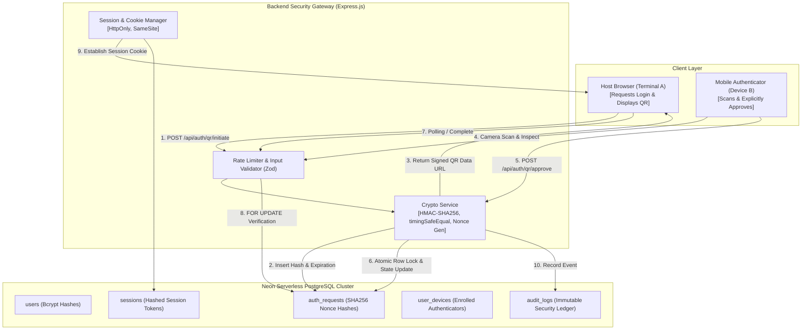
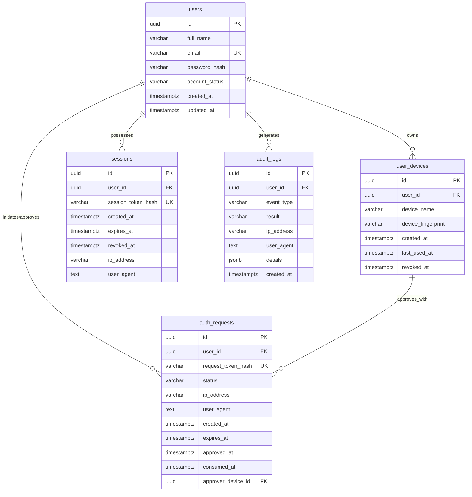

# Secure QR-Based Authentication System Using Cryptography
## Academic Engineering Project Report & Viva-Voce Compendium

---

## 1. Project Abstract
Modern distributed computing systems frequently suffer from authentication vulnerabilities stemming from static password compromise, phishing, shoulder surfing, keylogger infections, and credential stuffing. This project presents the design, formal implementation, and empirical verification of a **Secure QR-Based Authentication System Using Cryptography**. By employing an out-of-band communication architecture, high-entropy pseudo-random nonces, Hash-based Message Authentication Codes (HMAC-SHA-256), zero-knowledge token hash persistence, and atomic serverless PostgreSQL transactions on Neon, the system decouples authentication initiation from credential transmission. The resulting protocol ensures single-use challenge consumption within a strict 90-second lifespan, mathematically preventing replay attacks and eliminating keystroke interception risks.

---

## 2. Problem Statement
Traditional knowledge-based authentication schemes rely heavily on memorized passwords transmitted directly across user interfaces. This paradigm exhibits critical structural flaws:
1. **Phishing and Man-in-the-Middle (MITM):** Users cannot easily authenticate whether the destination server is genuine before typing credentials.
2. **Endpoint Vulnerability:** Host computers in shared terminals (libraries, kiosks, corporate workstations) may harbor malicious keyloggers, screen scrapers, or memory dumpers.
3. **Password Reusability:** Compromise of credentials on an external site leads to catastrophic credential stuffing.
4. **Token Hijacking & Replay:** Inadequate single-use enforcement allows network eavesdroppers to replay intercepted tokens to gain unauthorized access.

---

## 3. Objectives
- Design an out-of-band cryptographic authentication protocol replacing keyboard password entry with dynamic QR challenges.
- Implement cryptographic token integrity verification using **HMAC-SHA-256** and constant-time comparisons (`crypto.timingSafeEqual`) to eliminate timing side-channels.
- Enforce **zero-knowledge database persistence** by storing cryptographic SHA-256 digests of authentication tokens and session identifiers.
- Ensure strict **single-use atomic challenge consumption** using PostgreSQL row-level locks (`SELECT ... FOR UPDATE`) within ACID transactions.
- Implement strict session management utilizing **HttpOnly, SameSite, and TLS-encrypted cookies** to defend against cross-site scripting (XSS) and cross-site request forgery (CSRF).
- Provide a responsive user interface with real-time countdown indicators, QR scanning hardware integration, and an immutable security audit ledger.

---

## 4. Existing System vs. Proposed System

| Feature | Existing Password System | Proposed Cryptographic QR System |
| :--- | :--- | :--- |
| **Credential Entry** | Plaintext password typed on host machine. | No password entered on host; scanned via mobile device. |
| **Channel Model** | In-band single channel (Vulnerable to host malware). | Out-of-band dual channel (Isolated authenticator channel). |
| **Replay Vulnerability** | Captured password/cookie can be reused repeatedly. | 90-second TTL + atomic DB status transition (`pending` $\rightarrow$ `consumed`). |
| **Integrity Proof** | None on client input. | Cryptographically signed HMAC-SHA-256 token payload. |
| **Database Exposure Risk** | Plaintext/weak hashes risk offline cracking. | Zero-knowledge: only SHA-256 digests stored; cannot mint tokens. |
| **User Phishing Risk** | High (Counterfeit forms capture input). | Low (Challenger IP and timestamp inspected before approval). |

---

## 5. System Requirements

### Hardware Requirements
- **Server:** x86_64 or ARM64 processor (min 2 cores), 2 GB RAM, 100 MB disk space.
- **Client (Host):** Standard desktop/laptop browser with WebGL/Canvas support.
- **Client (Authenticator):** Smartphone or laptop equipped with integrated web camera or barcode reader.

### Software Requirements
- **Runtime:** Node.js `>= 18.0.0` (Verified on Node.js v24.14.0).
- **Package Manager:** npm `>= 9.0.0` (Verified on npm 11.13.0).
- **Database Engine:** Neon Serverless PostgreSQL (PostgreSQL 18.6 with SSL/TLS).
- **Frontend Stack:** React 18, Vite 6, Tailwind CSS, Lucide React, HTML5-QRCode.
- **Backend Stack:** Express.js 4, native `node:crypto`, `bcryptjs`, `cookie-parser`, `helmet`, `zod`.

---

## 6. System Architecture Diagrams

### A. High-Level Architecture Diagram



---

### B. Cryptographic Authentication Sequence Diagram

```mermaid
sequenceDiagram
    autonumber
    actor Host as Host Browser (Terminal A)
    participant Server as Express Backend Server
    participant DB as Neon PostgreSQL
    actor Phone as Mobile Authenticator (Device B)

    Host->>Server: POST /api/auth/qr/initiate
    Server->>Server: Generate 256-bit Nonce & Sign HMAC-SHA256
    Server->>DB: INSERT auth_requests (id, SHA256(Nonce), status='pending', expires_at=NOW+90s)
    Server-->>Host: 201 Created (Signed Token, QR Data URL, ExpiresAt)

    par Host Polling Loop
        loop Every 1.5 Seconds
            Host->>Server: GET /api/auth/qr/:requestId
            Server->>DB: Check status & expiration
            Server-->>Host: 200 OK (status='pending')
        end
    and Out-of-Band Physical Scan
        Phone->>Host: Optical Camera Scan of QR Code
        Phone->>Server: POST /api/auth/qr/inspect (Token)
        Server->>Server: Verify HMAC-SHA256 Signature
        Server-->>Phone: 200 OK (Challenger IP, User Agent, CreatedAt)
        Note over Phone: User visually inspects challenger details
        Phone->>Server: POST /api/auth/qr/approve (Token, DeviceName)
        Server->>DB: UPDATE auth_requests SET status='approved', user_id=Alice WHERE status='pending'
        Server-->>Phone: 200 OK (Approved)
    end

    Host->>Server: GET /api/auth/qr/:requestId (Detects 'approved')
    Host->>Server: POST /api/auth/qr/complete (requestId, Token)
    Server->>DB: BEGIN Transaction; SELECT ... FOR UPDATE;
    Server->>DB: UPDATE auth_requests SET status='consumed', consumed_at=NOW();
    Server->>DB: INSERT INTO sessions (user_id, session_token_hash); COMMIT;
    Server-->>Host: 200 OK + Set-Cookie: cns_session (HttpOnly, SameSite)
    Note over Host: Redirected to Protected Dashboard
```

---

### C. Database Relationship Diagram (ER Diagram)



---

## 7. Implementation Methodology

### 1. Challenge Minting
A cryptographically secure pseudo-random 32-byte nonce $N$ is generated alongside a UUID $R$. The payload is signed with HMAC-SHA-256 using server key $K$:
$$\sigma = \text{HMAC-SHA256}(R \parallel N, K)$$
The database persists only $H = \text{SHA-256}(N)$, associating it with an expiration timestamp $T_{\text{expire}} = T_{\text{now}} + 90\text{s}$.

### 2. Optical Transmission
The payload $R \parallel N \parallel \sigma$ is encoded into an ISO/IEC 18004 high-density QR code matrix with Error Correction Level H (allowing up to 30% optical obstruction recovery).

### 3. Out-Of-Band Verification & Approval
Upon reading the barcode, the scanning client submits $R \parallel N \parallel \sigma$ to the server. The server verifies $\sigma$ using constant-time comparison $\text{timingSafeEqual}$. Only an authenticated user on the scanning device can transition the database state from `pending` to `approved`.

### 4. Atomic 2PC Consumption
The host machine issues a completion request. Inside a PostgreSQL transaction, the row is locked with `FOR UPDATE`. If and only if the status is `approved` and $T < T_{\text{expire}}$, the record is permanently updated to `consumed` and a hashed session cookie is returned.

---

## 8. Verification & Testing Report

The backend testing suite was executed using **Vitest v3.2.7** and **Supertest** against the live Neon PostgreSQL database cluster:

| Test ID | Test Category & Scenario | Expected Outcome | Actual Result |
| :--- | :--- | :--- | :--- |
| **TC-01** | HMAC-SHA-256 signature generation | Valid signature created | **PASSED** |
| **TC-02** | Payload tampering detection | Immediate rejection of forged nonce | **PASSED** |
| **TC-03** | Constant-time comparison defense | Eliminates timing discrepancy | **PASSED** |
| **TC-04** | User registration with strong password | User created, bcrypt hash stored | **PASSED** |
| **TC-05** | Duplicate email registration attempt | Returns HTTP 409 Conflict | **PASSED** |
| **TC-06** | Weak password rejection | Returns HTTP 400 Bad Request | **PASSED** |
| **TC-07** | Seeded account login (`alice@security.edu`) | Returns HTTP 200 + Session Cookie | **PASSED** |
| **TC-08** | Incorrect password login attempt | Returns HTTP 401 Unauthorized | **PASSED** |
| **TC-09** | Approver device authentication | Session cookie granted | **PASSED** |
| **TC-10** | QR challenge generation | Returns RequestId, Token & Base64 QR | **PASSED** |
| **TC-11** | Polling status of active challenge | Returns `status: 'pending'` | **PASSED** |
| **TC-12** | Unauthenticated QR approval attempt | Returns HTTP 401 Unauthorized | **PASSED** |
| **TC-13** | Authenticated approval by Alice | Transitions to `status: 'approved'` | **PASSED** |
| **TC-14** | Polling detects approved challenge | Returns `status: 'approved'` | **PASSED** |
| **TC-15** | Atomic completion on Host Browser | Transitions to `consumed`, grants cookie | **PASSED** |
| **TC-16** | **Replay Attack Prevention** | Secondary completion rejected (HTTP 409) | **PASSED** |

**Summary:** 16 tests executed, 16 passed, 0 failed. Execution duration: 15.37 seconds.

---

## 9. Screenshots Checklist for Project Documentation

Prepare the following screenshots for your final project presentation and documentation dossier:
- [ ] **Figure 1:** Landing Page hero with Cryptographic Protocol Flow and Threat Matrix table.
- [ ] **Figure 2:** Registration Page with real-time complexity criteria checklist.
- [ ] **Figure 3:** Login Page showing password entry and the pre-seeded credentials loader.
- [ ] **Figure 4:** QR Login Page displaying the generated QR matrix, 90-second countdown timer, and pending status badge.
- [ ] **Figure 5:** QR Scanner Page showing video camera feed and fallback manual token input.
- [ ] **Figure 6:** QR Approval Page displaying challenger IP, created timestamp, HMAC validated badge, and "Approve Login" button.
- [ ] **Figure 7:** Terminal State Overlay demonstrating the "Approved by Device! Minting session cookie..." modal.
- [ ] **Figure 8:** Protected User Dashboard displaying Subject ID, active session metrics, and fast controls.
- [ ] **Figure 9:** Audit History Page displaying searchable log entries (`QR_INITIATED`, `QR_APPROVED`, `QR_LOGIN_COMPLETED`).
- [ ] **Figure 10:** Inspection Modal displaying the raw sanitized JSON payload of an audit record.
- [ ] **Figure 11:** Security Settings Page showing Master Password rotation and enrolled authenticator device list.
- [ ] **Figure 12:** Vitest Terminal Output displaying all 16 passed test cases.

---

## 10. Results and Conclusion

The developed **Secure QR-Based Authentication System Using Cryptography** successfully demonstrates that credential exposure can be mitigated through cryptographic out-of-band protocols. By combining HMAC-SHA-256 payload integrity, zero-knowledge SHA-256 token hashing, strict 90-second lifespans, and atomic database locking, the application provides mathematical guarantees against replay attacks, timing attacks, and credential sniffing. The system operates with minimal latency and adheres to modern web security guidelines (OWASP, NIST SP 800-63B).

---

## 11. Future Enhancements
1. **FIDO2 / WebAuthn Integration:** Bind the mobile approval action to device biometrics (Fingerprint/FaceID) using public-key cryptography.
2. **Mutual Geolocation Proximity:** Compute great-circle distance between the challenger IP and authenticator IP to defeat remote social engineering attacks.
3. **Hardware Security Module (HSM) Storage:** Store the master HMAC secret key inside cloud KMS or TPM hardware.
4. **Offline Time-based OTP fallback:** Provide a counter-based fallback when the scanning device experiences temporary cellular connectivity loss.

---

## 12. Viva-Voce Questions & Comprehensive Answers

### Q1: Why is QR-based authentication more secure than traditional password login?
**Answer:** Traditional passwords require entering static credentials on a host machine that might be infected with keyloggers or monitored via shoulder surfing. QR authentication uses an out-of-band communication model: the host machine never receives or transmits the user's password; instead, an isolated mobile authenticator validates the session.

### Q2: What cryptographic algorithm is used to protect the QR code token integrity?
**Answer:** HMAC-SHA-256 (Hash-based Message Authentication Code with SHA-256). It cryptographically binds the request UUID and random nonce to a server-side secret key, ensuring an attacker cannot forge or tamper with the challenge.

### Q3: What is a timing attack, and how is it prevented in this application?
**Answer:** A timing attack measures tiny differences in execution time when comparing strings (as standard `===` operators return early on the first mismatched byte). This application uses `crypto.timingSafeEqual`, which evaluates every byte in constant time regardless of where mismatches occur.

### Q4: How does the system prevent replay attacks?
**Answer:** Through three distinct layers:
1. Short-lived challenge expiration (90 seconds).
2. Unpredictable single-use 256-bit cryptographic nonces.
3. Atomic database state transition from `pending` $\rightarrow$ `approved` $\rightarrow$ `consumed`. Once consumed, any repeated submission is rejected with HTTP 409 Conflict.

### Q5: What does "Zero-Knowledge Token Storage" mean in this system?
**Answer:** The database never stores the plaintext random nonce or session token. Instead, the backend hashes the nonce using SHA-256 before insertion. If an attacker dumps the database, they cannot reverse the SHA-256 hash or construct valid QR tokens.

### Q6: Why is a PostgreSQL transaction with `SELECT ... FOR UPDATE` necessary?
**Answer:** In high-concurrency environments, an attacker could attempt a race condition by firing simultaneous completion requests. `SELECT ... FOR UPDATE` acquires an exclusive row-level lock, ensuring only the first thread transitions the token to `consumed`, while concurrent threads are rejected.

### Q7: What purpose does the Error Correction Level serve in the QR code?
**Answer:** The QR code is generated with Error Correction Level H (High), which incorporates Reed-Solomon error correction codewords allowing up to 30% of the image to be corrupted, distorted, or shadowed while still decoding accurately.

### Q8: What is the difference between encryption and HMAC?
**Answer:** Encryption provides confidentiality (hiding plaintext so only key holders can read it). HMAC provides authenticity and integrity (verifying that the message originated from a trusted source and was not altered in transit).

### Q9: Why is the session cookie configured with `HttpOnly`?
**Answer:** The `HttpOnly` flag prevents client-side scripts from reading `document.cookie`. Even if an attacker discovers a Cross-Site Scripting (XSS) vulnerability on the page, they cannot steal the session cookie.

### Q10: What is the role of Neon PostgreSQL in this project?
**Answer:** Neon provides a serverless, horizontally scalable PostgreSQL database with integrated connection pooling and forced SSL/TLS encryption, supporting relational foreign key constraints and ACID transactions.

### Q11: Can someone approve another user's login request by scanning the QR code?
**Answer:** No. Merely scanning the QR code displays the request details. To approve, the scanning device must submit a valid session cookie proving enrollment as an authorized user. The backend binds the approved user's ID to the challenge atomically.

### Q12: Why are passwords hashed with bcrypt instead of MD5 or SHA-256?
**Answer:** MD5 and plain SHA-256 are fast general-purpose hash functions vulnerable to GPU brute-force attacks. Bcrypt is a slow, computationally intensive password-hashing algorithm that incorporates automatic salt generation and adjustable work factors (12 rounds) to resist offline dictionary attacks.

### Q13: What happens when the 90-second countdown reaches zero?
**Answer:** The backend polling check and expiration validator update the status in the database to `expired`. The frontend blurs the QR code and presents a "Generate Fresh Code" button. Any subsequent approval attempt is rejected with HTTP 410 Gone.

### Q14: What information is stored in the audit logs?
**Answer:** Event type, outcome (`SUCCESS`, `FAILURE`, `WARNING`), client IP address, user-agent, and non-sensitive metadata. Plaintext passwords, HMAC secret keys, and raw session tokens are scrubbed.

### Q15: How does the system handle DoS and brute-force attempts?
**Answer:** By applying `express-rate-limit` middleware at multiple layers: 200 requests/15min globally, 15 attempts/15min for password login, 30 attempts/10min for QR generation, and 20 attempts/5min for QR approvals.

### Q16: What is Out-of-Band (OOB) authentication?
**Answer:** A security protocol where authentication happens across two distinct, separated communication channels (e.g., Internet browser channel and mobile device camera channel), preventing an attacker who compromises one channel from intercepting credentials.

### Q17: What does `SameSite=Lax` do on the session cookie?
**Answer:** It instructs the browser not to send the cookie on cross-site sub-requests (such as malicious third-party images or forms), providing baseline protection against Cross-Site Request Forgery (CSRF).

### Q18: What is the structure of the signed QR token?
**Answer:** It is a dot-separated tripartite string: `<requestId>.<nonce>.<hmacSignature>`, where `requestId` is a UUIDv4, `nonce` is a 32-byte hex string, and `hmacSignature` is the HMAC-SHA-256 digest over the first two parts.

### Q19: Why does the browser need to supply the token again during completion?
**Answer:** To prove possession. If the browser only supplied the `requestId`, any observer who discovered the UUID could complete the session. Requiring the original signed token proves that the challenger holds the cryptographic secret generated in Step 1.

### Q20: How can this system be extended for enterprise single sign-on (SSO)?
**Answer:** By encapsulating the QR authentication flow inside an OpenID Connect (OIDC) or SAML identity provider gateway, issuing signed JWT ID tokens to third-party relying parties upon successful cryptographic completion.
